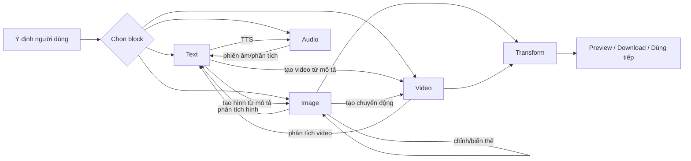
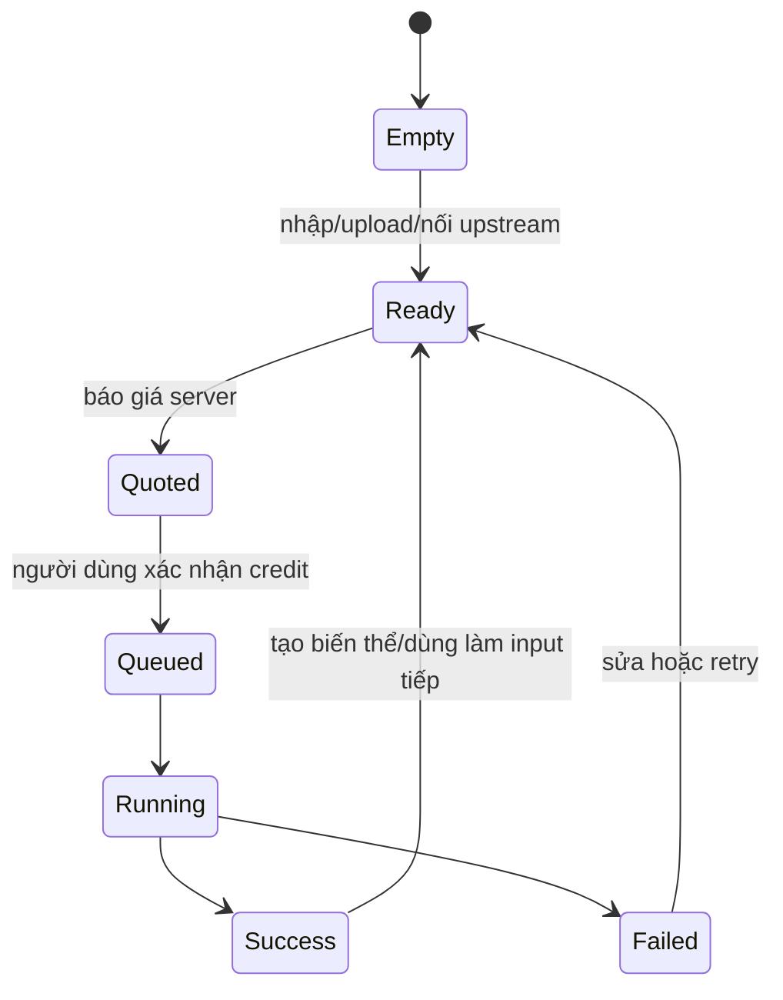

# Target UX Blueprint — Canvas như dây chuyền sáng tạo

## Mô hình đích

Người dùng chỉ thấy bốn loại block: **Text, Image, Video, Audio**. Import,
manual, generate và output là trạng thái/hành động bên trong block. ToolSpec cụ
thể được `Presentation Adapter` chọn dựa trên modality, upstream và intent.

## Ngữ pháp block

| Block | Empty state | Khi có upstream | CTA chính |
|---|---|---|---|
| Text | `Viết` hoặc `Tạo bằng AI` | Text: biên tập/hợp nhất; Image/Video/Audio: phân tích | `Tạo văn bản` / `Phân tích` |
| Image | `Tải ảnh` hoặc `Tạo bằng AI` | Text: text-to-image; Image(s): edit/combine/reference | `Tạo ảnh` |
| Video | `Tải video` hoặc `Tạo bằng AI` | Text: text-to-video; Image(s): image-to-video; Video: transform thật | `Tạo video` |
| Audio | `Tải audio` hoặc `Tạo bằng AI` | Text: TTS; media: chỉ hiện intent có executor | `Tạo audio` |

Không hiện `asset.image`, `image_keys`, `params_schema`, app slug, provider key,
callback hay raw JSON cho user thường.

## Ngữ pháp dây

1. Mỗi box có một `+` output 28–32 px ở cạnh phải; input tương thích sáng lên khi
   kéo, input không hợp lệ mờ đi.
2. Thả vào box tương thích nối ngay. Thả vào khoảng trống mở menu **kết quả tiếp
   theo**, không mở toàn catalog.
3. Menu theo output:
   - Text: `Tạo ảnh`, `Tạo video`, `Viết tiếp/biên tập`, `Tạo giọng đọc`.
   - Image: `Chỉnh/biến thể`, `Tạo video`, `Phân tích ảnh`, `Nâng cấp ảnh`.
   - Video: `Phân tích video`, `Tách frame`, `Nâng cấp`, `Ghép video`.
   - Audio: chỉ hành động có executor như `Phiên âm/phân tích` hoặc input media.
4. Mỗi đích hiển thị `Tên box · Ý định`, ví dụ `Phân tích sản phẩm · Phân tích
   ảnh`, không bao giờ lặp `text.generate · image_keys`.
5. Dây có mũi tên. Màu nhẹ theo modality; chỉ animate khi job đang chạy. Giữa
   dây có nút `+` để chèn bước tương thích; click dây cho reconnect/delete.
6. Client chặn cycle/invalid sớm và nói lý do bằng tiếng Việt; server vẫn quyết
   định cuối cùng.

## Composer

- Chỉ một composer hiện tại một thời điểm; nằm dưới, cao mặc định 144–180 px,
  không phủ node được chọn; Canvas tự chừa safe area.
- Hàng 1: prompt/ý định; `@` chỉ liệt kê node tương thích theo label.
- Hàng 2: tối đa 4–6 chip nghiệp vụ: Model, tỉ lệ, độ phân giải, thời lượng,
  số lượng, server/fallback nếu người dùng thực sự cần.
- CTA phải hiện `n credit · Tạo/Phân tích`; click mở confirm gồm phạm vi node,
  upstream sẽ chạy, giá tối đa và quyền hủy.
- Advanced/Dev là drawer riêng do user chủ động mở; đóng lại không đổi graph.

## Run và trạng thái

- `Run node`: chạy node được chọn cùng prerequisite thiếu.
- `Run from here`: chạy node và downstream hợp lệ; phải preview danh sách.
- `Run flow`: chạy toàn flow; chỉ ở top bar và có preflight.
- Node/card, edge và run drawer dùng cùng một state source; không có bốn nhãn
  mâu thuẫn “Báo giá/Chạy/Tạo bằng AI”.

## Chrome tối giản mặc định

- Top bar: Back, tên workflow/autosave, Undo/Redo, Share, `Run flow`, credits.
- Rail: Select, Add, Templates/Flows, Assets/History; Layers/Frame/Note/Comment
  vào `More` đến khi user hoàn thành first-run.
- Nền gần đen kiểu neutral, lưới chấm nhẹ, không dùng pure black. Theme lưu theo
  user; thay default cũ phải cập nhật quyết định nền tảng đúng giao thức.
